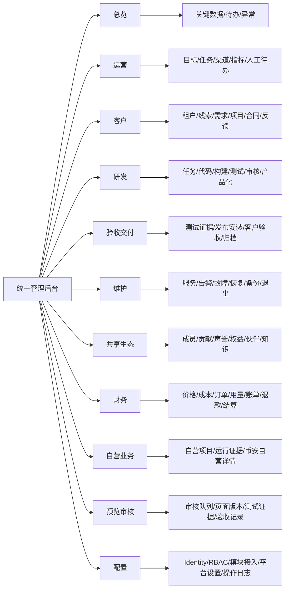

# 玄钧AI新统一管理后台：冻结信息架构 V1

> 状态：`OWNER_CONFIRMED / FROZEN_BASELINE_V1`
>
> 日期：2026-10-30
>
> 范围：产品梳理、信息架构、只读界面候选；不代表后台、数据源或生产接线已完成。

## 1. 实际学习与复用材料

- 工作区 `AGENTS.md`；仓库内产品/UI专用 `AGENTS.md`、`SKILL.md`：`NONE_FOUND`。
- `DEVELOPMENT_V27_ECOLOGY_V11_20261014.md`：平台定位、角色、模块、商业财务、交付、任务、恢复、自营与治理。
- `PROJECT_DELIVERY_CONTRACT_V1_20261030.md`：项目、页面、UI版本、变更、安装及验收的同一事实链。
- `DIGITAL_TWIN_READ_MODEL_V1_20261030.md`、`DIGITAL_TWIN_SUPERVISION_V1_20261030.md`：项目/节点/AI只读投影与UNKNOWN原则。
- `TASK_CENTER_USABILITY_CLOSEOUT_20261026.md`、MCP/ModelControl文档：任务、attempt、执行、审核、恢复与真实回执。
- PR122客户中心实施/变更/登录/私有材料规则：现有Identity/RBAC、项目、私有预览和逐页反馈边界。
- `demos/task-center-digital-twin/**`：现有TEST_ONLY入口；复用信息层次经验，不覆盖其页面。
- 旧离线孪生 `DESIGN_SYSTEM.md` 与组件规范：复用token和响应式原则，不把旧离线页面当最新确认稿。

公开成熟产品参考（只学习模式，不复制品牌、页面或角色）：

- [Cloudscape service navigation](https://cloudscape.design/patterns/general/service-navigation/)：全局工具与服务导航分层。
- [Cloudscape details page](https://cloudscape.design/patterns/resource-management/details/details-page/)：资源摘要、面包屑和详情动作。
- [Cloudscape table view](https://cloudscape.design/patterns/resource-management/view/table-view/)：筛选、排序、空态、错误态和显示偏好。
- [Jira statuses](https://support.atlassian.com/jira-cloud-administration/docs/what-are-issue-statuses-priorities-and-resolutions/)：状态、优先级、解决结果分离。
- [GitLab permissions](https://docs.gitlab.com/user/permissions/) 与 [merge request approvals](https://docs.gitlab.com/user/project/merge_requests/approvals/)：角色来源和独立审核。
- [Ant Design Grid](https://ant.design/components/grid/)、[Steps](https://ant.design/components/steps/)、[Drawer](https://ant.design/components/drawer/)：响应式、分步和渐进披露。

## 2. 信息架构图



冻结二级导航：

| 一级域 | 二级入口 |
|---|---|
| 总览 | 一眼总览 |
| 运营 | 目标与计划、运营任务、渠道与活动、经营指标、异常与人工待办 |
| 客户 | 客户与租户、CRM线索、需求与SOW、客户项目、合同与权益、客户反馈 |
| 研发 | 开发任务、仓库与版本、构建与制品、测试与质量、独立审核、模块产品化 |
| 验收交付 | 测试证据、发布与安装、客户验收、交付与归档 |
| 维护 | 服务与运行时、健康与告警、事件与故障、检查点与恢复、备份与演练、到期与安全退出 |
| 共享生态 | 生态成员、贡献记录、声誉与凭证、生态权益、伙伴与推荐、方案知识与产品化 |
| 财务 | 产品与价格、成本与利润、报价与订单、钱包与用量、账单与付款、对账退款、推荐结算 |
| 自营业务 | 自营项目、运行证据 |
| 预览审核 | 审核队列、页面与版本、测试证据、验收记录 |
| 配置 | 身份与RBAC、模块接入、平台设置、操作日志 |

未接二级入口允许进入统一 `NOT_CONNECTED/UNKNOWN/NONE_FOUND` 状态页，但不得生成业务记录。

### 2.1 管理后台与数字孪生边界

- 管理后台按对象提供数据总览、筛选、列表、详情、权限范围操作和操作日志。
- 数字孪生继续由原任务中心维护运行关系、状态变化、事件和AI动态；本仓库不复制其场景、动画或健康投影。
- 两者只用 `tenant_id/project_id/task_id/object_ref/evidence_ref` 关联并互跳；业务事实仍来自原 CRM、Registry、Git、Task、Finance、Service Catalog 等生产者。
- 数字孪生当前只有 TEST_ONLY 入口；管理后台只保留带来源和状态的对象引用，不把它升级为生产事实。

### 2.2 原七模块权威来源

原七模块由 `REUSABLE_SCHEDULER_KERNEL_20261025.md` 第9行固定为：运营、客户、研发、验收交付、维护、共享生态、财务。V2.7提供其业务范围：运营对应1.8/10章，客户对应2.5/8章，研发对应9章，验收交付对应8.7/9章，维护对应5章及10.4–10.6/10.14/10.17，共享生态对应7章及11.1/11.2/11.9，财务对应6章。七项只是管理分类，不是七套数据库或账本。

## 3. 全文档覆盖映射

| 功能域 | 主要角色 | 导航/页面 | 原事实生产者 | 候选状态 |
|---|---|---|---|---|
| 总览、待办、消息、异常 | Owner、运营、责任人 | 总览/指标与待办 | Task/Event/Outbox、监控、项目、财务投影 | 部分来源已有；跨域聚合待接 |
| 客户、租户、项目 | 平台管理员、客户Owner、PM | 客户/列表/详情 | Identity/RBAC、CRM、Customer Project Center | `NOT_CONNECTED` |
| 团队、角色、权限 | 平台/租户管理员、安全审计 | 配置/身份与RBAC | Identity、Organization、RBAC、Audit | 文档定义；统一接口待核 |
| AI应用、模块、版本、发布、使用 | 产品、开发者、客户 | 研发/模块产品化；共享生态/方案知识 | Module/Version Registry、Entitlement、Usage、Artifact | 离线表达；生产待接 |
| 定制项目全链 | 客户、PM、Writer、QA、Audit、交付 | 客户与项目/需求/原型/UI/开发/交付/售后 | PR122、Task Registry、Git/Artifact、Finance | 部分源码已有；适配器待接 |
| 预览与逐页审核 | Owner、客户验收人、Reviewer | 预览与审核/列表/详情/工作区/比较 | Project Delivery Contract、PR122 Preview/Changes | 契约已有；生产 adapter `NOT_CONNECTED` |
| 任务与AI执行 | Coordinator、Developer、QA、Auditor | 研发/开发任务 | Task Supervisor、GatewayKernel、ModelControl | TEST_ONLY投影已有 |
| 数字孪生 | Owner、授权客户 | 原任务中心独立入口；后台仅对象跳转 | 同一Task/Event/Evidence只读投影 | TEST_ONLY；不复制页面 |
| 客服、知识、渠道 | 客服、客户成功、知识管理员 | 运营/渠道与活动；客户/客户反馈 | CRM、Customer Brain、渠道适配器 | 复用资产；统一接线待核 |
| 商业与财务 | Commercial、Finance、客户财务、审计 | 财务/价格、订单、用量、账单、对账 | Price Book、Contract、Order、Ledger、Usage | 不由前端推断财务事实 |
| 自营业务 | 业务负责人、运营、风控、Finance | 自营业务/项目列表/详情/运行证据 | 原自营CRM/Finance/执行资产 | 币安为生态内业务，不是独立平台 |
| 运维、审计、设置 | SRE、安全、审计、平台管理员 | 维护；配置/平台设置与操作日志 | Monitoring、Backup、Audit、配置/部署回执 | 设置动作回原服务鉴权 |

## 4. 项目预览与审核中心

```text
预览与审核
├── 全部项目 / 待Owner审核 / 待客户确认 / 修改中 / 待复验 / 已归档
└── 项目详情
    ├── 摘要：需求基线、当前阶段、负责人、阻塞、证据完整度
    ├── 页面与版本清单
    ├── 可点击预览（候选内置或原受保护入口）
    ├── 审核工作区：页面树 / 当前预览 / 意见与证据
    ├── 版本对比
    ├── 测试与独审
    ├── 安装回执
    ├── 验收结果
    └── 完整事件时间线
```

每个预览入口绑定：

`tenant_id + project_id + page_id + ui_version + environment + task_id + attempt_id + commit/artifact_sha + evidence_ref`

旧网址只作为 `legacy_entry_ref`；不保存裸URL，不强制iframe，不绕鉴权/CSP。固定返回路径为：审核工作区 → 项目详情 → 项目列表。

## 5. 状态与权限

制品/环境层级独立显示：`设计稿`、`合成演示`、`开发版本`、`已安装`、`已验收`。前一状态不得推导后一状态。

页面审核状态：`CONFIRMED`、`PENDING_CHANGE`、`PENDING_RECHECK`、`PENDING_ACCEPTANCE`、`ACCEPTED`、`REJECTED`、`BLOCKED_BASELINE_UNCONFIRMED`、`UNKNOWN`。

接线状态：`NOT_CONNECTED`、`NOT_EXECUTED`、`HOLD`、`UNKNOWN`、`SOURCE_IMPLEMENTED`、`INTERFACE_WIRED`、`REAL_VERIFIED`。

- Owner/平台管理员跨项目查看仍逐对象服务端鉴权。
- 客户仅访问本租户获授权项目；项目Owner不自动等于正式验收人。
- Writer提交候选但不得自审或验收；QA、独审、客户验收职责分离。
- AI不得代Owner、客户、Finance或审核人签字。
- 跨租户拒绝时不泄露对象是否存在。
- 密钥只显示受保护引用和状态，对Owner也不显示明文。

## 6. 旧入口兼容与文件边界

- 新候选：`demos/owner-workbench-v2/**`。
- 未来测试路由候选：`/task-center-test/workbench-v2/`。
- 保留 `/task-center-test/`、`admin.html`、`login.html`、`/customer/center/`、`/customer/projects/` 及既有私有preview入口。
- 未确认前不做301/308，不覆盖现有任务中心、官网、客户中心或数字孪生作者文件。
